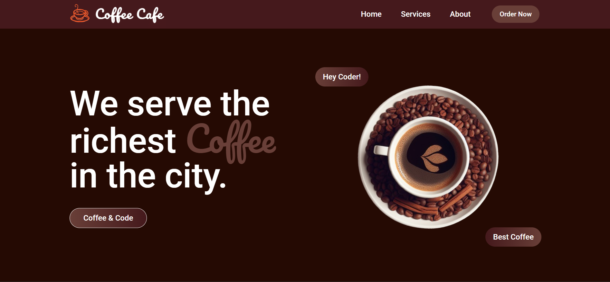

# ☕ Coffee Cafe — React Frontend Web Page

> Responsive coffee shop landing page built with React, Vite, and Tailwind CSS

🔗 **Live Demo:** [Click](https://coffee-cafe-ruddy.vercel.app/)



---

## ✨ Features

- 🦸 Hero section with a slowly rotating coffee image and gradient call-to-action buttons
- 🧭 Responsive Navbar with smooth-scroll anchor links and an animated mobile sidebar menu
- ☕ Services section with hover-animated cards rendered from a data array
- 📖 About section with icon highlights
- 📱 App download section with App Store / Play Store badges
- 💬 Testimonials carousel with autoplay, pause on hover, and 3 / 2 / 1 slides by breakpoint
- 📰 Footer with link columns and contact info
- 🎨 Custom Tailwind theme colors and Google Fonts (Roboto, Pacifico)

---

## 🛠️ Built With

- React 19
- Vite
- Tailwind CSS v4
- react-slick + slick-carousel
- react-icons
- Oxlint
- Google Fonts (Roboto, Pacifico)
- JavaScript (ES6+)

---

## 🚀 Getting Started

### Prerequisites

- A recent Node.js LTS version
- npm

### Installation

```bash
git clone https://github.com/hameed-codes/coffee-cafe.git
cd coffee-cafe
npm install
npm run dev
```

---

## 📁 Folder Structure

```
coffee-cafe/
├── public/
├── src/
│   ├── assets/
│   ├── components/
│   │   ├── About.jsx
│   │   ├── Footer.jsx
│   │   ├── Hero.jsx
│   │   ├── MobileStores.jsx
│   │   ├── Navbar.jsx
│   │   ├── ServiceCard.jsx
│   │   ├── Services.jsx
│   │   ├── Testimonials.jsx
│   │   └── TestimonialsCards.jsx
│   ├── App.css
│   ├── App.jsx
│   ├── index.css
│   └── main.jsx
├── .gitignore
├── .oxlintrc.json
├── index.html
├── package-lock.json
├── package.json
├── README.md
└── vite.config.js
```

---

## 📄 License

This project is open source and available under the [MIT License](LICENSE).

---

## 👤 Author

**Made with ❤️ by [Hameed Khan](https://github.com/hameed-codes)**  
[GitHub](https://github.com/hameed-codes) · [LinkedIn](https://linkedin.com/in/hameed-khan-86157339a)